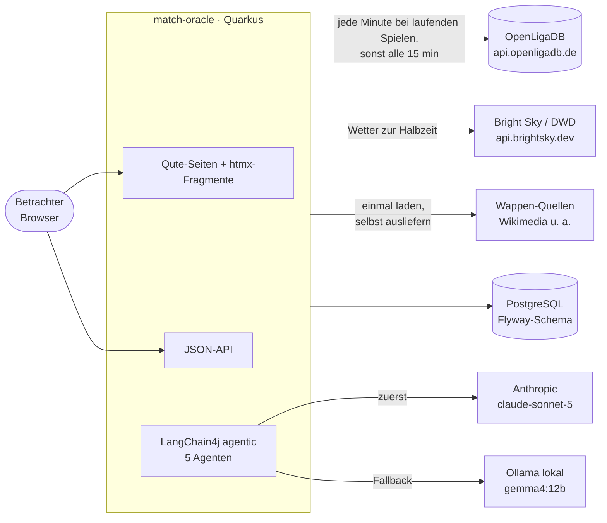
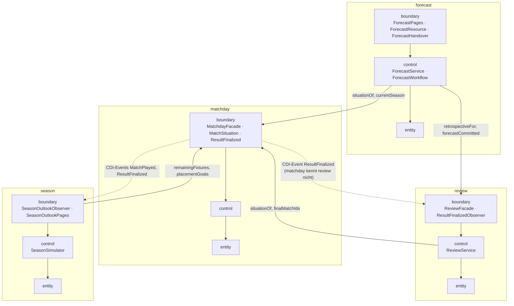

# Architektur „Rasen-Radar – mit KI-Vorschau“

Stand: November 2026. Quarkus 3.39, Java 21, Maven Wrapper. Basispackage `de.javamark.matchoracle`.

## Inhalt

| Dokument | Inhalt |
|---|---|
| [README.md](README.md) (dieses) | Überblick, Kontext, Feature-Schnitt, Abhängigkeitsregeln |
| [ablaeufe.md](ablaeufe.md) | Die wichtigen Abläufe als Sequenz- und Flussdiagramme mit Verweis auf die Klassen |
| [entscheidungen.md](entscheidungen.md) | Architekturentscheidungen im knappen ADR-Stil |

Verwandte Dokumente außerhalb dieses Verzeichnisses: die fachlichen Specs unter `docs/specs/`, die Kostenschätzung `docs/kosten-cloud-modelle.md`, der UI-Styleguide `docs/styleguide.md`, die Arbeitsregeln und das Glossar in `CLAUDE.md`.

## Was die Anwendung tut

Die Anwendung hält Begegnungen und Ergebnisse der 1. und 2. Bundesliga (laufende Saison plus zwei Vorsaisons) aktuell, dazu zur reinen Ansicht DFB-Pokal, Nations League (Liga A) und die Champions-League-Ligaphase. Sie leitet daraus Tabelle, Form, direkte Duelle und Saisonauswertungen ab, simuliert für die Tabellenwettbewerbe (Bundesligen, Champions League) die Saisonaussicht je Verein und erstellt auf Wunsch je Bundesliga-Begegnung eine KI-Vorschau: drei Bewerter-Agenten, ein Prognostiker und ein Prüfer liefern Tendenz, Wahrscheinlichkeiten, Richtwert für das Ergebnis, Sicherheitsgrad und Begründung. Sobald ein Ergebnis endgültig ist, bewertet die Rückschau jede dazu festgeschriebene Prognose und weist eine Trefferbilanz aus, gemessen an einer statistischen Basisprognose. Keine Quoten, keine Wettempfehlungen.

## Kontext

| Baustein | Technik | Wo |
|---|---|---|
| Spieldaten | OpenLigaDB, REST-Client (`quarkus-rest-client-jackson`), kein API-Key | `matchday.control.OpenLigaDbClient` |
| Wetter | Bright Sky (DWD), nur für Spiele in den nächsten 10 Tagen, im Speicher gehalten | `matchday.control.WeatherService`, `BrightSkyClient` |
| Wappen | einmal heruntergeladen, in der DB gespeichert und unter `/crests` selbst ausgeliefert | `matchday.boundary.CrestScheduler`, `CrestResource` |
| Persistenz | PostgreSQL, Hibernate ORM mit Panache (Active Record), Flyway-Migrationen `V1`–`V19` | `*/entity`, `src/main/resources/db/migration/` |
| Agenten | `quarkus-langchain4j-agentic` (deklarativer Workflow), Anthropic + Ollama | `forecast.control` |
| Zeitsteuerung | `quarkus-scheduler` (Sync, Wappen, automatische KI-Vorschau, Nachholläufe) | `matchday.boundary.MatchdaySyncScheduler`, `CrestScheduler`, `forecast.boundary.ForecastScheduler`, `ForecastHandover`, `review.boundary.ReviewCatchUp` |
| UI | Qute (`@CheckedTemplate`), htmx 2 und Chart.js 4 lokal unter `META-INF/resources/vendor/`, kein SPA, kein Login; Vorlieben („Mein Verein“, ausgeblendete Abschnitte) nur im Browser | `*/boundary/*Pages`, `src/main/resources/templates/` |
| Architekturtest | ArchUnit | `src/test/java/de/javamark/matchoracle/ArchitectureTest.java` |
| Entwicklung | Compose Dev Services (`compose-devservices.yml`, Postgres 18, fester Port 5432) | `application.properties`, `%dev`-Profil |

## Feature-Schnitt: BCE je Feature

Jedes fachliche Feature ist ein Package mit den drei Schichten Boundary, Control, Entity. Innerhalb eines Features gilt: `boundary → control → entity`, nie rückwärts. Über Feature-Grenzen hinweg darf ausschließlich das `boundary`-Package des anderen Features benutzt werden.

| Feature | Spec | Boundary (Einstiege) | Control (Fachlogik) | Entity (Modell) |
|---|---|---|---|---|
| `matchday` | 01 Spieltagsdaten, 06 Pokal und Nations League | `MatchdayPages`, `MatchdayPageModels`, `MatchdayResource`, `SearchPages`, `MatchdaySyncScheduler`, `CrestScheduler`, `MatchdayFacade`, `MatchSituation`, Events `MatchPlayed`, `ResultFinalized` | `MatchdaySynchronizer`, `OpenLigaDbClient`, `ResultFinalizer`, `StandingsCalculator`, `FormCalculator`, `HeadToHeadCalculator`, rund 20 weitere `*Calculator` für Saisonseite, Pokal und Gruppen, `WeatherService`, `TravelCalculator` | `League`, `CompetitionFormat`, `Matchday`, `Match`, `Team`, `Goal`, `Score`, `ResultStatus`, `Decision`, `Standings`, `PlacementGoal` |
| `forecast` | 02 Spieltag-Prognose | `ForecastPages`, `ForecastResource`, `ForecastScheduler`, `ForecastHandover` | `ForecastQueue`, `ForecastService`, `ForecastWorkflow`, `FormAssessor`, `HeadToHeadAssessor`, `ContextAssessor`, `Forecaster`, `Reviewer`, `ResilientAssessors`, `FallbackChatModel`, `FactSheet`, `ForecastProgress`, `JsonAnswerRepair` | `Forecast`, `Assessment`, `ForecastParameters`, `Outcome`, `Verdict` |
| `review` | 03 Rückschau und Lernen, 05 Prognose nachvollziehbar | `ResultFinalizedObserver`, `ReviewFacade`, `ReviewCatchUp`, `ReviewPages`, `ReviewResource` | `ReviewService`, `Evaluation`, `Similarity`, `RetrospectiveText`, `MatchdayRecap` | `Situation`, `RecordedForecast`, `ForecastEvaluation`, `SimilarCase`, `Retrospective`, `AccuracyReport`, `Baseline`, `ContrarianReport` |
| `season` | 04 Saisonaussicht | `SeasonOutlookObserver`, `SeasonOutlookBackfill`, `SeasonOutlookPages` | `SeasonSimulator`, `SeasonOutlookService`, `SeasonTargets` | `SeasonOutlook`, `SeasonThreshold` |

## Abhängigkeiten zwischen den Features

Regeln, die `ArchitectureTest` prüft:

1. **BCE-Schichten** (`bce_layers`): innerhalb eines Features darf `entity` weder `control` noch `boundary` kennen, `control` nicht `boundary`.
2. **Zusammenarbeit nur über Boundary** (`features_collaborate_only_via_boundary`): keine Klasse greift in `control` oder `entity` eines fremden Features.
3. **Keine Zyklen** (`features_are_free_of_cycles`): die Feature-Packages sind als Slices zyklenfrei.

Daraus ergibt sich der erlaubte Graph `forecast → {matchday, review}`, `review → matchday` und `season → matchday`; `matchday` selbst kennt kein anderes Feature. Die fachlich nötige Rückrichtung `matchday → review` (ein Ergebnis wird endgültig, die Rückschau soll reagieren) läuft über das CDI-Event `ResultFinalized`, das in `matchday.boundary` liegt und von `review.boundary.ResultFinalizedObserver` beobachtet wird. Genauso rechnet `season` die Saisonaussicht neu, sobald ein Spieltag komplett gespielt ist (`MatchPlayed`) und noch einmal, wenn die Ergebnisse endgültig sind (`ResultFinalized`). `forecast → review` ist dagegen ein direkter Aufruf (`ReviewFacade.forecastCommitted`), weil `forecast` ohnehin von `review` abhängt (Rückschau). Fremde Features sehen nie Entities: `MatchdayFacade` liefert `MatchSituation` (Records mit reinen Werten), `ReviewFacade` nimmt `CommittedForecast` entgegen und gibt die Rückschau als Text zurück.

Auf HTML-Ebene wird die Abhängigkeitsrichtung ebenfalls eingehalten: die Seiten des `matchday`-Features laden per htmx Fragmente von `forecast` (`summary`, `markers`, `projection`), `review` (`/trefferbilanz/spiel/…`) und `season` (`outlook`), ohne dass `matchday`-Java-Code diese Features kennt.

## Persistenz auf einen Blick

| Migration | Inhalt |
|---|---|
| `V1__matchday_schema.sql` | `team`, `matchday` (unique `league, season, number`), `match`, `goal`; eine Sequenz je Entity |
| `V2`, `V4`, `V9` | Alter der Daten, Wappen-URL |
| `V3__forecast_schema.sql` | `forecast_parameters` (eine Zeile), `forecast` (Check: Wahrscheinlichkeiten summieren zu 1), `assessment` |
| `V5`–`V8` | Rückschau: `situation`, `recorded_forecast`, `forecast_evaluation`, Rücktest-Flag, Basisprognose, Ergebnistreffer |
| `V10__season_outlook_schema.sql` | Saisonaussicht je Verein und Platzierungsziel |
| `V11`, `V12` | „Gegen den Strom“: abweichende Prognosen und ihre Bilanz |
| `V13`–`V15` | Pokal und Nations League: Gruppe, Rundenname, Abschnittsnummer, Entscheidung (Verlängerung, Elfmeterschießen) |
| `V16`–`V18` | Spielklasse je Verein (für Pokal-Überraschungen), Zwischenstand laufender Spiele, gespeicherte Wappen |
| `V19__season_threshold.sql` | Typische Punktzahl je Tabellenplatz („Was braucht {Verein}?“) |

Hibernate läuft mit `schema-management.strategy=validate`; das Schema gehört Flyway.

## Einstiegspunkte (HTTP)

| Pfad | Feature | Art |
|---|---|---|
| `/`, `/{league}`, `/{league}/{season}/{number}`, `/{league}/matches/{id}`, `/{league}/teams/{id}`, `/{league}/saison`, `/{league}/torschuetzen`, `/{league}/konferenz`, `/{league}/vergleich`, `/mein-verein`, `/suche` | matchday | HTML |
| `/live/…`, `/wetter/…`, `/{league}/{season}/{number}/live-tabelle`, `/crests/…`, `*.ics` | matchday | htmx-Fragmente, Bilder, Kalender |
| `/leagues/{league}/...` | matchday | JSON |
| `/{league}/matches/{id}/forecast` (+ `/progress`, `/summary`, `/buehne`), `/{league}/{season}/{number}/forecasts` (+ `/markers`, `/projection`), `/{league}/{season}/{number}/backtests`, `/strom/ki-vorschau`, `/so-entsteht-eine-prognose` | forecast | HTML / htmx-Fragmente |
| `/forecasts/...` | forecast | JSON |
| `/trefferbilanz` (+ `/leaderboard`, `/spiel/{matchId}`) | review | HTML / htmx-Fragmente |
| `/review/accuracy/{league}`, `/review/evaluations/{forecastId}` | review | JSON |
| `/{league}/{season}/teams/{id}/outlook` (+ `/targets`) | season | htmx-Fragmente |

Wettbewerbe werden überall über ihre Kürzel angesprochen: `bl1`, `bl2`, `dfb` (DFB-Pokal), `nla` (Nations League) und `ucl` (Champions League). Die KI-Vorschau gibt es nur für die beiden Bundesligen, die Saisonaussicht zusätzlich für die Champions League; Pokal und Nations League sind reine Ansicht.
